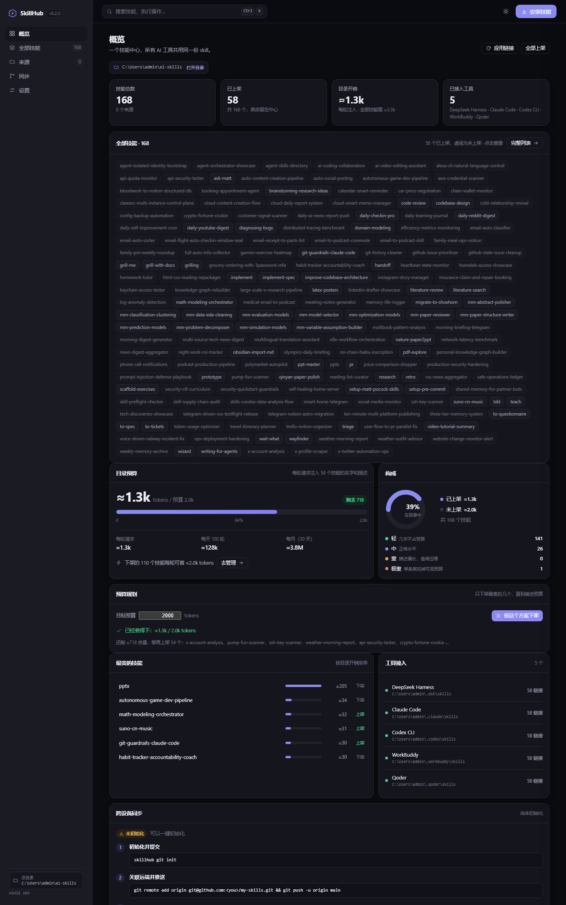

<div align="center">

# SkillHub

**一个技能中心，所有 AI 工具、所有设备共用同一份 skill。**

装一次，处处可用 · 可视化控制台 · 零依赖 · 零配置

[](./LICENSE)
[](https://nodejs.org)
[](./package.json)
[](./test)
[](./docs/maintenance.md)

</div>

---

## 它解决什么问题

你在 GitHub 上下载了一个 skill，然后发现：

- **每个工具都要装一遍**。Claude Code 认 `~/.claude/skills`，Codex 认 `~/.codex/skills`，Cursor、WorkBuddy、Qoder 各有各的目录。同一份内容复制五六份，改了一处，其余全过期。
- **模型目录被塞爆**。agent 每一轮请求都会带上所有技能的「名字 + 描述」。168 个技能 ≈ 1.6 万字符 ≈ 1 万 tokens，**每轮对话都在为用不上的技能付费**。
- **换台电脑就从头再来**。技能散落在各工具目录里，没法同步、没法版本管理、没法审查。
- **看不见、摸不着**。想关掉一个技能，只能去翻目录删文件夹；想知道哪个技能最贵，只能自己数。

SkillHub 把这些收敛成一个模型：

> **一份技能，放在中心；每个工具看到的是指向中心的链接；控制台管开关；git 管跨设备同步；MCP 让远端设备也能调用。**

## 核心特性

| 特性 | 说明 |
| --- | --- |
| 🗂 **单一来源** | 技能只存一份在 hub，工具目录里全是链接（Windows junction / POSIX symlink），改一次全局生效 |
| 🎚 **上架 / 下架** | 技能留在中心但可以「下架」——链接消失、模型目录里不再出现，token 立刻省下来 |
| 📊 **成本可见** | 每个技能标注目录开销（≈tokens）；首页有预算条、每轮/每天/每月换算、最贵技能排行 |
| 🖥 **可视化控制台** | 侧边栏五个视图、搜索筛选、网格/表格切换、SKILL.md 阅读器、`Ctrl K` 命令面板 |
| 🖱 **拖拽导入** | 把技能文件夹直接拖进控制台，自动找到 `SKILL.md` 并安装（浏览器端上传，不需要命令行） |
| 🔀 **同步面板** | 一键 `git init` + 首提交，界面直接给出「推到远端 / 另一台设备怎么接」的命令 |
| 🔌 **MCP 服务** | `skillhub mcp` 把整个中心暴露给任何 MCP 客户端，远端设备/远端模型也能列技能、读技能、装技能 |
| 📦 **一条命令安装** | `skillhub add owner/repo` 走 codeload 拉 zip，不需要 git、不需要 token、不占 API 限额 |
| 🛡 **不误删** | 只删「自己创建的链接」，遇到手工装的真实目录会报 `blocked` 并跳过 |
| 🪶 **零运行时依赖** | 只有 Node 内置模块；没有 `npm install` 这一步，装不上的内网机器也能跑 |

## 界面



控制台是「概览 / 技能 / 来源 / 同步 / 设置」五个视图：

- **概览**：四项 KPI（技能总数、已上架、目录开销、接入工具）+ **全部技能索引**（168 个名字一屏看全，虚线的是未上架，点开即看 SKILL.md）+ 预算条 + 构成环图 + 最贵技能排行 + 工具接入状态 + 同步卡片。
- **全部技能**：搜索、按上架状态/斜杠命令筛选、按名称/开销/更新时间排序，网格或表格两种布局；卡片上的开关直接上架/下架，点卡片滑出 SKILL.md 全文。
- **来源**：每个技能来自哪个仓库、什么时候装的。
- **同步**：git 状态（分支、remote、未提交改动）与下一步命令，可一键初始化。
- **设置**：目录预算、每日请求数、主题、批量上架/下架、重新应用链接。

**总目录在哪？** 侧边栏底部有一个「总目录」按钮，概览页标题下也有一条路径胶囊，点一下直接在文件管理器里打开中心文件夹；每个技能的抽屉里同样有一条可点的路径。局域网访问时（远端打不开本机窗口）会自动降级为复制路径。

其它细节：`Ctrl/⌘ + K` 打开命令面板（可搜索技能、跳视图、执行动作）；`/` 聚焦搜索框；把文件夹拖到窗口任意位置即可导入；每次开关都有「撤销」；视图写在 URL hash 里（`#/skills`），可直接分享或刷新保持。浅色/深色跟随系统，也能手动切换。

## 工作原理

```
                    ┌──────────────────────────────┐
                    │        ~/.skillhub           │   ← 唯一真实来源
                    │  tdd/  pdf-explore/  ppt-master/ …  │      （一个 git 仓库）
                    │  skillhub.json  ← 上架名单     │
                    └───────────┬──────────────────┘
                                │  链接（junction / symlink）
        ┌───────────┬───────────┼───────────┬────────────┐
        ▼           ▼           ▼           ▼            ▼
   ~/.dsh/skills  ~/.claude/skills  ~/.codex/skills  ~/.cursor/skills  …
        │           │           │           │
        ▼           ▼           ▼           ▼
   DeepSeek      Claude Code    Codex      Cursor      ← 各自以为技能在自己目录里
   Harness
                                ▲
                                │  HTTP / MCP
                    ┌───────────┴──────────────┐
                    │  skillhub serve  :4711   │   ← 可视化控制台 + REST + MCP
                    └───────────┬──────────────┘
                                │
                        另一台电脑 / 另一个模型
```

**为什么用链接而不是复制？** 复制会漂移。链接让「中心」成为唯一事实：删掉、改掉、切分支，所有工具立刻看到同一份。Windows 上用 junction，**不需要管理员权限、不需要开发者模式**。

**为什么下架能省 token？** 技能目录是「工具扫到的目录里的 SKILL.md 文件名 + frontmatter description」。下架 = 移除链接 = 该技能不在任何工具的扫描结果里 = 模型看不到它 = 不产生目录开销。技能本体仍在中心，随时可以再上架。

## 快速开始

```bash
# 1. 建中心（默认 ~/.skillhub）
npx skillhub init

# 2. 装一个技能包（GitHub 短名、链接、或本地文件夹都行）
npx skillhub add mattpocock/skills

# 3. 打开控制台
npx skillhub serve
#    → http://127.0.0.1:4711
```

没有 npx？直接跑源码：

```bash
git clone https://github.com/xingaorpw/skillhub.git
cd skillhub
node src/cli.js init
node src/cli.js add mattpocock/skills
node src/cli.js serve
```

控制台里能看到：技能总数、已上架数量、**模型每轮要付的 token**、已接入的工具；点卡片看 SKILL.md 全文，拨开关即上架/下架，点「安装技能」填 `owner/repo` 就能装，也可以把技能文件夹直接拖进窗口。

## 命令行

| 命令 | 作用 |
| --- | --- |
| `skillhub init [dir]` | 建中心，自动探测本机有哪些 AI 工具 |
| `skillhub add <源…>` | 安装技能；源可以是 `owner/repo`、GitHub URL（支持 `/tree/分支/子目录`）或本地路径 |
| `skillhub list [--json]` | 列出技能、目录开销、上架状态 |
| `skillhub enable <名…>` | 上架并建立链接 |
| `skillhub disable <名…>` | 下架并移除链接（技能保留在中心） |
| `skillhub link [--dry-run]` | 按当前上架名单重算并应用所有链接（幂等） |
| `skillhub unlink <名…>` | 只移除指定技能的链接 |
| `skillhub remove <名…>` | 从中心删除技能 |
| `skillhub show <名>` | 打印某个技能的 SKILL.md |
| `skillhub serve [--port] [--host]` | 启动可视化控制台 + REST + MCP |
| `skillhub mcp` | 以 MCP 服务（stdio）方式运行 |
| `skillhub git [init\|status]` | 把中心变成 git 仓库 / 查看分支、remote、未提交改动 |
| `skillhub config [budget\|requests] [值]` | 读取或设置目录预算与每日请求数（驱动成本预测） |
| `skillhub tune [--budget N] [--apply]` | 算出该下架哪些技能才能装进预算，`--apply` 直接执行 |
| `skillhub doctor` | 自检：中心、工具、断链、冲突 |

常用参数：`--hub <dir>`、`--tool <id,id>`、`--dry-run`、`--overwrite`、`--json`、`--verbose`。

## 接到 MCP 客户端

`skillhub mcp` 提供 6 个工具：`list_skills`、`read_skill`、`enable_skill`、`disable_skill`、`install_skill`、`link_tools`，以及 `skill://<name>` 资源。

<details>
<summary><b>Claude Code / 兼容 MCP 的客户端</b></summary>

```json
{
  "mcpServers": {
    "skillhub": {
      "command": "node",
      "args": ["/absolute/path/to/skillhub/src/cli.js", "mcp"]
    }
  }
}
```
</details>

<details>
<summary><b>远端设备（HTTP）</b></summary>

在主机上：

```bash
skillhub serve --host 0.0.0.0
# 终端会打印一个 token，写请求需要带上
```

在另一台机器上向 `http://<主机>:4711/mcp` POST JSON-RPC 即可：

```bash
curl -s http://192.168.1.10:4711/mcp \
  -H 'content-type: application/json' \
  -d '{"jsonrpc":"2.0","id":1,"method":"tools/call","params":{"name":"list_skills","arguments":{}}}'
```
</details>

## 跨设备同步

中心就是一个普通文件夹 + 一个 `skillhub.json`，所以**用 git 同步**就是最自然的做法。控制台的「同步」页可以一键完成前两步：

```bash
skillhub git init       # git init -b main + .gitignore + 首次提交
cd ~/.skillhub
git remote add origin git@github.com:you/my-skills.git
git push -u origin main
```

另一台电脑：

```bash
git clone git@github.com:you/my-skills.git ~/.skillhub
skillhub link          # 按 skillhub.json 里的上架名单重建链接
```

链接里存的是**绝对路径**，所以新机器上不能直接 `git clone` 到别的位置再指望旧链接能用——`skillhub link` 会按当前路径重建，这一步是必须的，也是幂等的。详见 [docs/sync-across-devices.md](./docs/sync-across-devices.md)。

## Token 预算

agent 工具每轮都会注入「技能名 + description」。SkillHub 把这件事变成可度量、可操作的：

```
目录开销 ≈ Σ (name + description 的 token 数)
```

三层削减，互不冲突：

1. **少上架**：用不上的技能下架，本体留在中心；
2. **短描述**：description 保留触发词，砍掉长篇解释（`skillhub list` 会标出每个技能多贵）；
3. **斜杠命令**：`disable-model-invocation: true` 的技能不进模型目录，零成本，只能手动 `/调用`。

控制台把这套数字变成可读的仪表：

- **预算条**：默认 2000 tokens，超过 80% 变黄、100% 变红；预算和每日请求数可在「设置」或 `skillhub config budget 1500` 改。
- **成本预测**：每轮 / 每天（默认 100 轮）/ 每月（30 天）三档换算，把「每轮 1.3k」翻译成「每月 ≈390 万」。
- **分档**：每个技能按目录开销分成 轻 / 中 / 重 / 极重 四档，最贵的那几个一眼就能看到（实测 168 个技能里有一个 205 tokens 的「极重」技能）。
- **节省量**：下架技能后，界面直接显示「每轮可省 ≈2010 tokens」。
- **预算规划器**：控制台「预算规划」卡片或 `skillhub tune --budget 900` —— 给定预算，直接算出该下架哪几个
  技能（每次砍最贵的，所以下架数量最少）、每轮省多少、还剩几个在架上，一键应用并支持撤销。
  没超预算时反过来告诉你「余量够再上架 N 个」。这是从「你超了」到「这样就不超」的一步。

实测参考：168 个技能 ≈ 15.9k 字符 ≈ 1 万 tokens；压到 56 个可见 + 短描述 ≈ 1.3k tokens（**−93%**）。

## 安全模型

- **默认只听 `127.0.0.1`**。绑定 `0.0.0.0` 时会自动生成 token，写操作必须带 `x-skillhub-token`（或 `?token=`）。
- **只删自己建的东西**。`removeLink` 先 `lstat`，不是链接就拒绝；真实目录一律报 `blocked` 并保留。
- **不跟随链接递归删除**。这是 PowerShell `Remove-Item -Recurse` 会把目标一起删掉的经典坑，本项目用 `rmdir`（Windows）/ `unlink`（POSIX）精确移除链接本身。
- **解压防穿越**。zip 条目解析后校验目标路径必须落在解压目录内。
- **上传防穿越**。拖拽上传的每个文件路径都会校验（拒绝 `..`、盘符、绝对路径），先落到临时目录，再走和 `skillhub add` 完全相同的安装逻辑。
- **安装来源可审计**。`skillhub.json` 记录每个技能来自哪个仓库、什么时候装的。

## 目录结构

```
skillhub/
├── src/
│   ├── cli.js                 # 命令入口
│   ├── core/
│   │   ├── frontmatter.js     # SKILL.md 的 YAML frontmatter 读写
│   │   ├── hub.js             # 中心：扫描、安装、删除、汇总、偏好
│   │   ├── installer.js       # GitHub / 本地安装
│   │   ├── importer.js        # 拖拽上传：重建目录树后走同一条安装路径
│   │   ├── git.js             # git 状态与一键初始化（缺失时优雅降级）
│   │   ├── linker.js          # 链接创建与安全移除
│   │   ├── plan.js            # 链接计划（先算后做，支持 dry-run）
│   │   ├── tools.js           # 各 AI 工具的技能目录注册表
│   │   ├── tokens.js          # token 估算、分档、成本预测
│   │   └── zip.js             # 极简 zip 解压
│   ├── server/
│   │   ├── api.js             # REST 路由
│   │   ├── http.js            # 静态站点 + REST + MCP over HTTP
│   │   └── multipart.js       # 极简 multipart 解析（拖拽上传用）
│   └── mcp/server.js          # MCP（stdio + HTTP）
├── web/                       # 控制台（原生 HTML/CSS/JS，无构建）
│   ├── index.html             # 应用外壳：侧边栏 + 顶栏 + 抽屉 + 弹窗
│   ├── styles.css             # 设计变量、亮/暗主题、全部组件
│   ├── app.js                 # 状态 → 视图，命令面板、拖拽、撤销
│   └── markdown.js            # SKILL.md 渲染（转义 HTML）
├── test/                      # node:test 单元测试（112 个）
├── scripts/                   # test.js（跨版本跑测试）、check.js（自检）、smoke.js（端到端）
├── docs/                      # 架构、工具矩阵、跨设备同步、维护手册、上传清单
└── ROADMAP.md                 # 接下来要做什么
```

## 常见问题

<details>
<summary><b>Windows 上创建链接需要管理员权限吗？</b></summary>

不需要。SkillHub 用的是 **junction**（目录联接），普通用户即可创建，和需要管理员/开发者模式的 symlink 不同。
</details>

<details>
<summary><b>某个工具目录里已经有同名真实文件夹怎么办？</b></summary>

不会被覆盖。`link` 会把它标成 `blocked` 并跳过；`doctor` 会列出来。你确认后手工删掉再 `skillhub link` 即可。
</details>

<details>
<summary><b>支持哪些工具？</b></summary>

内置 DeepSeek Harness、Claude Code、Codex CLI、Cursor、WorkBuddy、Qoder、Windsurf、Gemini CLI、opencode。其它工具在 `skillhub.json` 里写一条 `tools` 就能接入，见 [docs/tools.md](./docs/tools.md)。
</details>

<details>
<summary><b>会动我已有的技能吗？</b></summary>

`add` 默认跳过已存在的同名技能（`--overwrite` 才覆盖）；`link` 只创建缺失的链接；`disable` 只删链接。只有 `remove` 会删除中心里的目录，且会先确认它不是链接。
</details>

<details>
<summary><b>可以 npm 安装 / 发布吗？</b></summary>

可以。包已经按发布标准准备好（`bin`、`files`、`engines`、`exports`、MIT 许可、`publishConfig`）：

```bash
npm i -g skillhub     # 装完后全局可用 skillhub 命令
npm pack --dry-run    # 看会打包哪些文件
npm publish           # 发布（需要先 npm login）
```

不想发布也可以 `npm i -g .` 在本机安装。
</details>

## 开发

```bash
npm test        # 112 个单元测试（node:test，无框架）
npm run smoke   # 18 项端到端检查：CLI → 链接 → 服务 → 上传 → git → MCP 握手
npm run check   # 语法、web 资源、package 元信息、README 链接自检
```

CI 在 Linux + Windows + macOS、Node 18/20/22/24 上跑这三条命令，见 [.github/workflows/ci.yml](./.github/workflows/ci.yml)。

准备推上 GitHub 或发 npm？[docs/github-upload.md](./docs/github-upload.md) 里有逐文件清单、推送步骤和常见坑。

## 维护

| | |
| --- | --- |
| 维护者 | [@xingaorpw](https://github.com/xingaorpw) |
| 节奏 | **每周一次**（周一）：跑 CI、处理 issue/PR、更新变更日志 |
| 最近一次维护 | 2026-11-06 |
| 支持范围 | Node 18 / 20 / 22 / 24，Windows / macOS / Linux |
| 响应 | issue 一般 7 天内首次回复；安全问题按 [SECURITY.md](./SECURITY.md) 走私密渠道，48 小时内确认 |

做事的顺序写在 [docs/maintenance.md](./docs/maintenance.md)：每周清单、发版流程、排障顺序。
接下来要做什么写在 [ROADMAP.md](./ROADMAP.md)，只保留「还没发出去的事」，做完就移进 [CHANGELOG](./CHANGELOG.md)。

自动化承担了一部分重复劳动：CI 在每次 push/PR 跑 3 系统 × 4 版本的矩阵，并且**每周一 03:00 UTC 定时再跑一次**（不需要有人提交，用来发现 Node 新版本把测试跑挂这类外部变化）；Dependabot 每周一检查 GitHub Actions 的版本。

## 贡献

欢迎 issue 和 PR，先读 [CONTRIBUTING.md](./CONTRIBUTING.md)。新增一个 AI 工具的目录支持只需要在 `src/core/tools.js` 加一行。

## 许可证

[MIT](./LICENSE)

---

<div align="center"><sub>

English: SkillHub keeps one copy of every agent skill and links it into each AI tool's directory, so a single install is visible everywhere. A local web console shows what the model actually pays for, and an MCP server lets other devices use the same library.

</sub></div>
